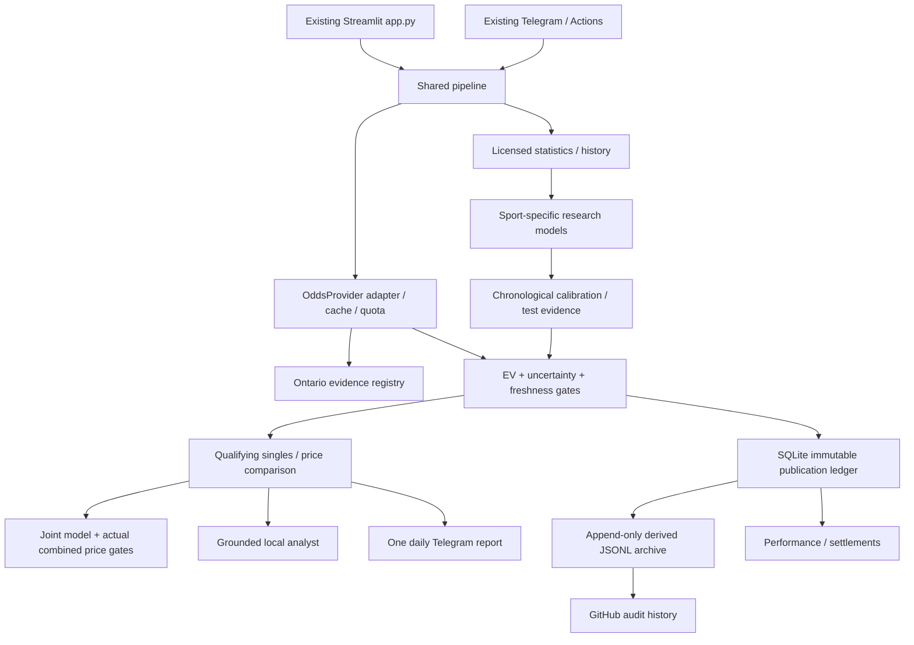

# Architecture and rollout boundaries

The existing repository and entrypoints are retained; no separate application,
service cluster, subscription system or paid account was created.

The automatic research increment adds `slate.py` as an opt-in orchestration path
of the existing `run_analysis`; the UI enables it. Zero-credit event discovery,
an age/fairness query queue, exact scope and partial-coverage audit precede the
existing model/EV pipeline. `book_optimizer.py` scores every eligible observed
single, uses exhaustive small-pool or disclosed beam research, and gates actual
qualified tickets separately. `slate_views.py` provides concise game/book cards;
raw observations stay in collapsed audit sections.

`processing.py` keeps immutable private shadow forecasts separate from published
bets, collects results for ended pending events within the same cap, scores
NBA/MLB full-final research targets and requires reviewed rules for published
settlement. `lifecycle.py` adds immutable candidate artifacts/actions, expanding
folds, cautious comparisons/drift and explicit activation gates. A reviewed exact
champion match is now required by the publication pipeline. No new champion exists.

`persistence.py` checks local health and makes consistent private backups.
`worker.py` is scheduler-neutral, offline/disabled by default; online operation
requires explicit durable-storage/data-rights configuration. Community Cloud
redeployment persistence and scheduled retraining are not supplied. The new
development-only Actions audit is manual, offline and read-only. See
[AUTONOMOUS_RESEARCH.md](AUTONOMOUS_RESEARCH.md) for exact operational boundaries.

`domain.py` holds immutable quote/estimate/opportunity contracts. `providers.py`
implements authorized odds retrieval and a protocol for future adapters. Event
identity includes the provider, market, side, line and player, preventing accidental
cross-line/participant comparison. Missing source times, malformed prices,
ambiguous duplicates, stale/suspended quotes and unknown jurisdictions fail closed.

`history.py`, `soccer.py`, `models.py`, `evaluation.py` separate statistics from
models and evidence. Historical odds never enter prediction features. Date-only
results exclude the entire event day; exact canonical aliases replace fuzzy joins.
A market baseline is complete-market normalized implied odds, excluding the target
book; it is labeled as a comparison and cannot qualify a selection by itself.

`ev.py` calculates EV, the implied probability, uncertainty-adjusted EV and an
explicit rank score. Only validated h2h models are eligible in this implementation.
There is no validated model artifact yet. Spread, Asian, total, prop and period
markets require their own forecast, settlement semantics and evidence.

`parlays.py` computes dependence-agnostic Frechet bounds when correlation evidence
is missing. It never multiplies leg prices to invent a combined offer. A genuine
combined quote must identify exactly the same book/legs, restrictions, provenance
and source time; a separately validated joint estimate is required. Opposing
match-winner selections and duplicate legs are rejected. Theoretical analysis
cannot become an executable recommendation through UI wording.

`parlay_research.py` is a separate discovery path that admits current Ontario
single observations even without validated estimates. It searches a bounded,
sport-balanced pool at one sportsbook, rejects incompatible score constraints,
flags dependence and ranks transparent research components. Theoretical price
products never become combined quotes or EV. `parlay_ui.py` exposes the selector;
`research_refresh.py` offers explicit quota-controlled retrieval, merging verified
snapshots across the existing dashboard/assistant without polling on filter changes.
`team_codes.py` contains exact archive name mappings. Historical forecasts carry
calibration sizes, data dates, uncertainty envelopes and publication blockers;
evaluation datasets must match before calibration is used. See
[PARLAY_RESEARCH.md](PARLAY_RESEARCH.md).

`markets.py` defines reviewed market keys, participant/line contracts and English
labels without inventing settlement scope. `market_ui.py` exposes explicit
featured/event searches and stale inspection. `data_settings.py` honors secure
environment/Streamlit Secrets settings; `quota.py` explains the local UTC-day cap
and Toronto reset time. Shared canonical cache and transactional `fetch_leases`
coalesce concurrent requests. Snapshot restoration preserves original timestamps;
narrow refresh merges by exact quote identity without duplicating other markets.

`advanced_models.py` adds paired NBA score scenarios, soccer goal and MLB run grids.
`market_validation.py` provides date-blocked, fixed-threshold forecast diagnostics,
not historical sportsbook returns or promoted models. Same-game score intersections
remain unvalidated scenarios, outside the qualified joint-estimate path. Player
history/context and integer/quarter-line settlement forecasts are missing.
`performance_ui.py` separates actual ledger outcomes from these diagnostics.
`bankroll.py`/`risk_ui.py` provide opt-in hypothetical loss calculations and guarded
fractional Kelly for evidenced singles only. See [ADVANCED_MARKETS.md](ADVANCED_MARKETS.md).

`storage.py` makes publications/settlements append-only with SQLite triggers.
`ledger.py` archives derived records with content IDs; restoration rejects conflicting
history. This small-store design avoids premature infrastructure. It is **not** a
multi-tenant production database. File modification outside the application remains
possible and must be detected with Git history, permissions and backups.

`analyst_context.py` builds read-only, redacted evidence for both assistant modes;
`assistant.py` preserves the free local answer interface. `chat_ui.py` supplies
session history, follow-ups, consent, expiry and clear controls. `analyst_config.py`
reads secure settings and fails closed. `llm.py` uses the official OpenAI Responses
SDK only after approval, key, consent and budget admission. Bounded current evidence
and recent questions/topics are sent with `store=False`, no remote conversation
state and no tools. Strictly validated evidence IDs drive server-rendered facts;
model-written numeric claims/prose never enter the answer. Quote age is rechecked
after the API wait. `analyst_usage.py` atomically reserves costs and counts in
SQLite; it stores no prompt, answer or key and preserves ambiguous reservations.
Local/remote modes are accurately labeled. Provider retention is separate from
session expiry; app caps are separate from provider billing. See
[OPENAI_ASSISTANT.md](OPENAI_ASSISTANT.md) for all defaults, privacy and future activation.

The live screen is a capability boundary: observed in-play odds do not establish
score, clock, event state, latency or suspension safety. No pregame model is reused
in play. A future live adapter needs synchronized score/state/odds timestamps,
sequence numbers, suspension detection, sport-specific remaining-game models and
cost-aware scheduling. Current code implements no live forecasting.

For commercialization, introduce user identity/tenant boundaries at the service
layer, a transactional managed database/object backup, separate subscriber views,
consented notifications, access limits and account-level quota. Keep adapters/model
interfaces stable so mobile or commercial API clients do not depend on Streamlit.
An external API needs explicit data-redistribution rights. Do not add infrastructure
or billable services until usage and contracts justify them.
# Focused portable prediction path — 2026-10-16

`epl_source` validates the publisher-CC0 result contract and exact aliases;
`epl_goal_model` fits prior-date decayed/shrunk scoring strengths;
`epl_validation` freezes chronological calibration, evaluates against baselines and
builds a hash-matched portable artifact; `epl_forecasts` checks live input coverage,
refreshes public current-season results at most daily and returns research estimates
to `pipeline`. Existing game cards, assistant facts and performance views consume
the same evidence. `processing` appends pregame paper forecasts and separate
source-target labels without ticket settlement or recommendation promotion.
There is no joint-parlay approval, actual-wager import, paid AI or new infrastructure.
See [the focused model guide](EPL_PREDICTIONS.md) for assumptions and reproducibility.
